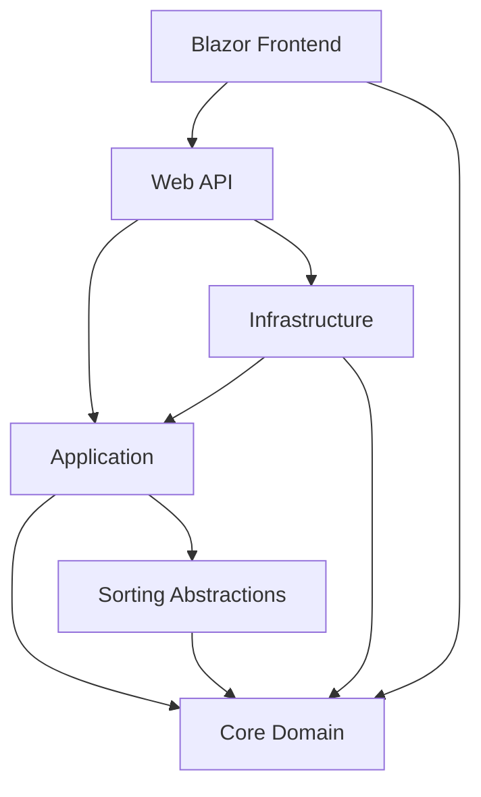
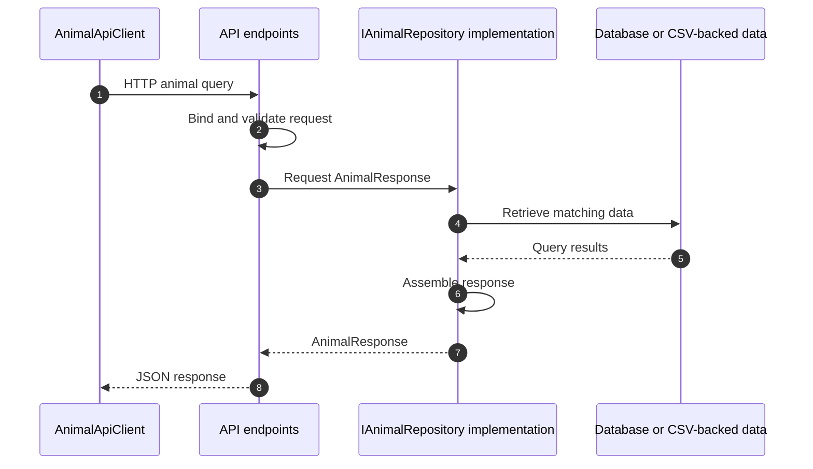
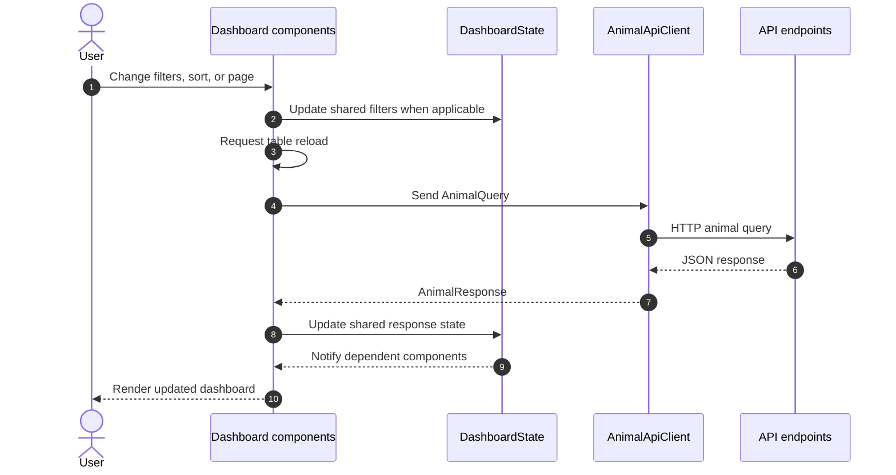

# Hi, I'm Peter

I am a Test Engineer and graduating computer science student with experience in C#, .NET, Python, C++, APIs and databases. My experience as a programmer began through independent exploration and problem-solving. Completing the computer science program has helped me build on that experience and fill in gaps in my knowledge, particularly in areas of requirements, architecture, algorithms, testing, security, and reverse engineering.

## Professional Self-Assessment

I began programming as a kid writing BASIC programs on a Commodore64 and later created my high school's first website. During my career in building and repairing guitars I built several iterations of websites for the business, did some light digital IO programming with Atmel microcontrollers, and learned enough about G-Code and CAM post-processor files to operate my own CNC router. These are examples of one of my core habits: I enjoy learning new technologies at a level of depth that helps me solve a problem well.

In early 2022 while working as an Electrical Engineering Technician I began learning Python so that I could automate repetitive engineering tests. I developed instrument drivers for VISA instruments, serial libraries for custom protocols, and a PyQt desktop application for running parameterized testing. After I was asked to port one of my protocol libraries to C# I was asked to transition into a Test Engineer role. I now develop test sequences and drivers in C#, contribute to a .NET Framework test executive, and build desktop applications in .NET 8.

I began pursuing my computer science degree in May of 2025 shortly after a promotion to Test Engineer to strengthen the foundations I'd learned through practical experience. Studying the software development life cycle, requirements-driven development, algorithms, databases, and iterative development has helped me move beyond developing code towards explaining why a particular design is appropriate and where its limitations are.

My capstone project demonstrates this progression through the Animal Rescue Dashboard enhancement. I transformed an earlier Python Dash application using MongoDB into a full-stack web application using Blazor, a .NET API, and PostgreSQL. Though I could have chosen different artifacts for enhanceement in the categories of software development and design, algorithms and data structures, and databases, I selected one artifact for all three enhancement categories so that I could also demonstrate my evolving understanding of proper program architecture.

The project showcased my ability to evaluate design trade-offs and pivot when needed. I implemented a reusable merge sort to demonstrate algorithmic reasoning, then reconsidered where sorting and filtering belonged when the application moved to WebAssembly, exposing performance problems. Moving data processing to the backend required changes to the API contract and underlined the importance of evaluating architectural decisions in their execution environment.

The project also demonstrates professional communication through an initial code review, enhancement narratives and before-and-after visuals. Interfaces and a repository abstraction helped me define clear responsibilities within the application and create clear boundaries that other developers could extend. These choices support maintainability and future collaboration, although this individually completed project does not demonstrate team-based development.

Security is an area where I am continuing to develop. During development I used defensive coding practices such as null checks and compiler warning review and recognized the need to distinguish between local development credentials and deployment credentials. While these practices contribute to reliability and security awareness, they are not a substitute for a complete assessment of threats, access controls, and deployment configurations.

Overall, this portfolio project represents both my technical strengths and my ability to evaluate my own work critically. I am increasingly comfortable integrating unfamiliar technologies, separating responsibilities, and revising a design when testing reveals limitations. My next areas of growth include frontend development, especially web considerations, responsive design, more explicit testing, and security analysis.

[GitHub](https://github.com/ptaylor-dev)
· [Email](mailto:peter@chellee.com)

## Project Overview: Animal Rescue Dashboard

For a capstone project at SNHU, CS students were instructed to select an artifact or artifacts from previous coursework and plan and execute enhancements in three distinct categories:
- Software Engineering and Design
- Algorithms and Data Structures
- Databases

#### Why did I choose this enhancement?

I chose this project for several reasons. First, I wanted to produce a single capstone artifact as a full stack application. I have been creating and working on desktop applications at work at various scales and wanted to showcase some of what I have learned, particularly about architecture. Second, I wanted to have something in my portfolio that was written in C# since it is the language I primarily use at work as a test engineer. Third, I wanted an excuse to work in Blazor. I've dabbled in React on my own and used Angular in class, but at work we've discussed using Blazor for future projects.

I deliberately chose a scope that would challenge me within the course timeline. My goal was to produce a cohesive application that demonstrated architectural reasoning, algorithm implementation, and database integration in a single artifact.

#### Live Demo

*The API for this demo is hosted on Render, which may be disabled due to inactivity. If the "Loading dashboard" message displays for more than a few seconds please reload the page.*

[View the Live Demo here!](https://ptaylor-dev.github.io/RescueAnimalDashboard/){:target="_blank" rel="noopener noreferrer"}


[Original artifact source code](https://github.com/ptaylor-dev/snhu-cs-340-client-server-development){:target="_blank" rel="noopener noreferrer"}

[Enhanced artifact source code](https://github.com/ptaylor-dev/RescueAnimalDashboard){:target="_blank" rel="noopener noreferrer"}


Original PyDash dashboard from CS-340 course


Completed enhancement

### Course Outcomes

Students were expected to use the enhancements in these three categories to demonstrate their alignment with the five course outcomes below.

1.	Employ strategies for building collaborative environments that enable diverse audiences to support organizational decision-making in the field of computer science.  
2.	Design, develop, and deliver professional-quality oral, written, and visual communications that are coherent, technically sound, and appropriately adapted to specific audiences and contexts.  
3.	Design and evaluate computing solutions that solve a given problem using algorithmic principles and computer science practices and standards appropriate to its solution while managing the trade-offs involved in design choices.  
4.	Demonstrate an ability to use well-founded and innovative techniques, skills, and tools in computing practices for the purpose of implementing computer solutions that deliver value and accomplish industry-specific goals.
5.	Develop a security mindset that anticipates adversarial exploits in software architecture and designs to expose potential vulnerabilities, mitigate design flaws, and ensure privacy and enhanced security of data and resources.

[See final course outcome alignment justification](#course-outcome-alignment-3)

## Enhancement Plan

While we could use up to three distinct artifacts for these enhancements, I opted to use the same artifact for all three. Since I have spent some time working in projects that were less organized, it was important to me to demonstrate a fullstack project with intentional architectural design in my final project.

The original artifact was produced 6 months prior in CS-340, Client/Server Development. The purpose was to use Python Dash to display information obtained from a MongoDB database, and to use features of Dash to filter and sort data records. My intention was rewrite this project as a Blazor web application with a .NET backend API and a PostgreSQL database.

### Code Review Video - Proposed Enhancement Plan



#### Software Engineering and Design

In the original project, the frontend consists of a data table with filtering and sorting, a bar chart, and a map that displays location data for each entry when selected. There are some additional radio buttons that are used for filtering for specific groups of dog breeds that are likely to perform well in different rescue training programs.

The UX is a bit clunky in the original project. The table is wider than the window and includes additional information that may not be helpful to the user. For example, each animal has an animal_id and a rec_num, which both appear to be unique identifiers. Only one is needed. Also, there is a datetime and monthyear column that contains identical data. I planned to remove redundant or unnecessary data from the table to provide for a cleaner focus and a better user experience.

After some research I had decided to use either MudBlazor or QuickGrid for displaying the table data, Plotly.js for the bar graph, and either Plotly.js or Leaflet for the map. Since this work was planned to be completed before any database work, I would create a simple CSV loader in the backend and use a repository pattern to access the datastore. This was intended to make it easy to transition to a database when the time came.

#### Algorithms and Data Structures

To demonstrate my knowledge of algorithms and data structures I decided to write my own sorting algorithm to use in sorting table data rather than using the database or MudBlazor sorting. The plan was to implement this in the frontend after data was returned from the API so that MudBlazor could easily trigger sorting logic. A stable sorting algorithm would allow for sorted data to remain in place, which would retain the cascading sort available in the Dash project.

I planned to use a test driven approach for this task, generating unit tests for various sorting scenarios, including already sorted data, empty datasets, single entry datasets, and missing data. This algorithm would be its own project so that it is not dependent on any other part of the solution.

In a real application this may not be an ideal design choice. Database calls can usually handle whatever sorting needs you have and provide better performance than grabbing the data from a datastore and sorting afterwards.

#### Databases

I planned to generate a PostgreSQL database with several relational tables to support the Blazor app created for category one. This database would have separate lookup tables for animal type, outcome type, and sex upon outcome to promote data integrity. I decided to use Entity Framework Core and my repository pattern to pivot from the CSV-based repository initially created.

## Category 1: Software Engineering and Design

### Artifact and Enhancement

I chose this project in particular for this category because it was ambitious. Transforming a high-level Python application of less than 375 lines into a fullstack web application felt like it would be a task worthy of a final capstone project.

### Design Decisions and Completed Work

The enhancement changed more than the application's language. I introduced explicit boundaries between presentation, API communication, and data access to reduce coupling across application layers. The IAnimalRepository interface allowed the application to work initially using CSV data and later with PostgreSQL through a shared contract. This let me develop the dashboard with real data before completing the database integration.

#### Dependency Direction



I started by writing some classes and interfaces that would help me define how the application would use that data. I created a simple API with only a Get method so that I could move the data into the web application. After verifying the API functionality using Postman, I was then able to start consuming and displaying the data in my web application.

The most obvious boundary was between the frontend and the backend at the API. The backend needed to be able to deliver the appropriate data through the API without knowing exactly how it would be consumed. 

#### Backend Sequence Diagram


The API accepts filtering, sorting, and pagination values through query-string parameters. The endpoint parses the supported enum values and constructs an AnimalQuery instance, which it then passes to the repository. The repository returns an AnimalResponse instance and the endpoint serializes that response as a JSON object. These two classes define the request and response contract used by the repository.

```csharp
{
    public sealed class AnimalQuery(
        RescueCategory? rescueType,
        string? searchText,
        AnimalSortOption? sortBy,
        AnimalSortOption? sortBySecondary,
        bool? sortAscending,
        int? pageIndex,
        int? pageSize,
        int? breedCountLimit)
    {
        private const int MaxPageSize = 100;
        private const int MaxBreedCountLimit = 100;

        public RescueCategory? RescueType { get; init; } = rescueType;
        public string? SearchText { get; init; } = searchText;
        public AnimalSortOption? SortBy { get; init; } = sortBy;
        public AnimalSortOption? SortBySecondary { get; init; } = sortBySecondary;
        public bool SortAscending { get; init; } = sortAscending ?? true;
        public int PageIndex { get; init; } = Math.Max(pageIndex ?? 0, 0);
        public int PageSize { get; init; } = Math.Clamp(pageSize ?? 10, 1, MaxPageSize);
        public int BreedCountLimit { get; init; } = Math.Clamp(
            breedCountLimit ?? 25, 1, MaxBreedCountLimit);
    }
}

public sealed class AnimalResponse(
    IReadOnlyList<Animal> animals,
    int pageIndex,
    int pageSize,
    int totalCount,
    int pageCount,
    List<BreedCount> breedCounts)
{
    public IReadOnlyList<Animal> Animals { get; } = animals;
    public int PageIndex { get; } = pageIndex;
    public int PageSize { get; } = pageSize;
    public int TotalCount { get; } = totalCount;
    public int PageCount { get; } = pageCount;
    public List<BreedCount> BreedCounts { get; } = breedCounts;
}
```

The AnimalQuery constructor normalizes pagination inputs by preventing negative page indexes and clamping page size and breed-count limits to defined ranges. These limits prevent a caller from requesting an arbitrarily large result page and help bound response size as a resource-control measure.

The backend could then be tested in isolation using Postman. Postman GET queries allowed for several different parameters to be tested to make sure that the information was returned as expected and that errors were handled properly.


With the API working in isolation I was able to use the information received to populate my presentation layer. This involved creating a unified DashboardState class that each of the UI elements could access to display the table, bar graph, and map data.

The MudBlazor table became the primary component in the dashboard and contained the API call and most of the state changes. The component would bind to elements in the state and the UI would update when state properties changed.

#### Frontend Sequence Diagram



### Challenges and Learning

#### LeafletFromBlazor

I had difficulty implementing the map as intended in this application. The original artifact used Dash-Leaflet, a wrapper around Leaflet.js. I found what I thought was a similar C# wrapper called LeafletFromBlazor, but I had a very difficult time getting the functionality I needed. I could get the map to display without issue, but adding points whenever an animal was selected did not remove previous selections. There did not appear to be a C# hook that would clear previous selections.

I decided to use Microsoft.JSInterop and just use the Leaflet.js library directly rather than the wrapper. This gave me the flexibility of the entire library so that I could add and remove map points easily as well as add information in popups.

### Course Outcome Alignment

This category enhancement aligns with all five outcomes. The most apparent is that rewriting this application as a web application demonstrates alignment with category 4, demonstrating an ability to use techniques, skills, and tools to implement solutions that accomplish industry-specific goals. It also involved designing computing solutions using appropriate computer science practices and standards while managing trade-offs. This can be seen in architectural decisions throughout the project, as well as the design of the API and query and response classes.

The code review video and documentation of this enhancement both demonstrate alignment with outcome 2 in delivering professional-quality oral, written, and visual communication that is coherent and appropriate to a specific audience.

Although this project was completed individually, outcome 1 is still supported by the implementation of proper architectural boundaries, commented code, and documentation that allow for readable and extendable code for any future developer.

Finally, a security mindset can be seen throughout the code by the use of TryParse methods, null checks, and default values in switch case statements, which aligns with outcome 5. This can also be seen by the use of max values enforced in the AnimalQuery object.

## Category 2: Algorithms and Data Structures

### Artifact and Enhancement

I had proposed to replace the included sorting functionality of the MudBlazor table with a plain C# merge sort algorithm. The decision to make this enhancement for the algorithms and data structures category was simple since it seemed the best way to demonstrate both algorithmic logic and tackle the challenge of sorting objects by properties.

### Design Decisions and Completed Work

The decision to use merge sort in particular was made because I wanted a way to mimic the built-in sorting functionality, which allowed for cascaded sorting, and merge sort would do that as it is a stable algorithm. Stable sorting algorithms preserve the relative order of elements whose keys compare equally. In my implementation, this supports successive sorts: sorting by the secondary key first and then applying a stable sort by primary key retains the secondary order within groups that share the same primary key. Merge sort is also efficient with a time complexity of O(*n*log*n*) and a space complexity of O(*n*), which meant that it would retain good performance as it scaled.

In my implementation I created a separate project for sorting. It can sort my Animal class instances by property but can just as easily sort any other class by property. The use of generics for sorting keys allowed me to end up with a single algorithm that can use any data type needed. Properties are passed into the method call with a lambda function, so the arguments determine what is sorted and how. The algorithm does not depend on the rest of the solution, instead I'm using an interface to allow for other sorting algorithms to be used in the future.

In the intermediate implementation, I maintained a sorted master collection and derived filtered collections from it. This avoided sorting again after every search change and it preserved the order established by successive sorts. However, moving the application to WebAssembly exposed the limitations of processing the complete dataset in the browser. In the final architecture I moved sorting, filtering, and pagination to the backend. [See Challenges and Learning](#challenges-and-learning-1)

It is worth noting that I opted not to use this algorithm for the EF Core repository, only for the CSV based repository. The PostgreSQL database implementation has its own sorting capabilities and I felt it was important to explore normal database interactions as well as be able to use my custom sorting algorithm. The live demo uses the Entity Framework Core / PostgreSQL repository, but you can switch to the CSV repository if you build the project locally. [See Databases for more information](#category-3-databases)

I used a test-driven approach to developing this sorting project. I created unit tests to cover the expected behaviors of the algorithm based on possible input types. Here is an example unit test that covers cascading sort in different directions of different object properties:

```csharp
[Fact]
public void TestMergeSortMultiSortedDifferentDirectionsData()
{
    var sorter = new MergeSorter();

    // Create a list of test data
    List<CustomDataStructure> testData = [];

    testData.Add(new CustomDataStructure { Num1 = 1, Num2 = 3 });
    testData.Add(new CustomDataStructure { Num1 = 2, Num2 = 2 });
    testData.Add(new CustomDataStructure { Num1 = 1, Num2 = 2 });
    testData.Add(new CustomDataStructure { Num1 = 2, Num2 = 1 });
    testData.Add(new CustomDataStructure { Num1 = 1, Num2 = 1 });
    testData.Add(new CustomDataStructure { Num1 = 2, Num2 = 3 });

    // Sort data by second parameter first
    var firstSort = sorter.Sort(testData, item => item.Num2);

    // Sort data by first parameter
    var result = sorter.Sort(firstSort, item => item.Num1, false);


    Assert.Collection(result,
        item1 =>
        {
            Assert.Equal(2, item1.Num1);
            Assert.Equal(1, item1.Num2);
        },
        item2 =>
        {
            Assert.Equal(2, item2.Num1);
            Assert.Equal(2, item2.Num2);
        },
        item3 =>
        {
            Assert.Equal(2, item3.Num1);
            Assert.Equal(3, item3.Num2);
        },
        item4 =>
        {
            Assert.Equal(1, item4.Num1);
            Assert.Equal(1, item4.Num2);
        },
        item5 =>
        {
            Assert.Equal(1, item5.Num1);
            Assert.Equal(2, item5.Num2);
        },
        item6 =>
        {
            Assert.Equal(1, item6.Num1);
            Assert.Equal(3, item6.Num2);
        });
}
```

I wrote the following behavior based unit tests:
*   TestMergeSortEmptyList
*   TestMergeSortAscendingOfSortedData
*   TestMergeSortAscendingOfUnsortedData
*   TestMergeSortDescendingOfUnsortedData
*   TestMergeSortMultiSortedData
*   TestMergeSortMultiSortedDifferentDirectionsData
*   TestMergeSortWithNullValues

While this is not exhaustive of the kinds of test I could have written, it does seem to cover the behaviors I expected could arise from different data inputs. I did not do any comparative performance testing of my sorting algorithm against either MudBlazor's or Entity Framework's built-in sorting capabilities.


### Challenges and Learning

#### Blazor Server vs WebAssembly

I had always thought I might want to try and use docker for the database for this project, so I began researching what it might look like, especially how it might affect deployment. It seemed that there were some good free options out there, but available options were dependent on whether I had a Blazor WebAssembly or Blazor Server project. I didn't remember which one I picked when I began and wasn't sure that it made a difference to me at the time. When I decided to deploy a WebAssembly frontend on GitHub Pages I began the task of migrating my Blazor Server project to WebAssembly.

This didn't end up being too complicated to change, but the performance dropped considerably, to the point where it was unusable. The search text was the worst. I would type two letters, and it took 5 seconds for them to show up on the screen. What I didn't realize at first was that the browser was now doing all my data processing, all the sorting and filtering, that was previously handled on the server. I began looking for every optimization I could find to get the response manageable again. It forced me to fix a lot of issues I had, but the performance is still slower than I'd like and ultimately led to major refactoring.

I ended up spending two more days moving all of the sorting, filtering, and pagination logic from the frontend, where it was close to the MudBlazor table, to the backend. In hindsight, this is of course where it should have been all along. My decision to use a homegrown merge sort had suggested to me that the frontend made more sense, but sorting and filtering 10,000 records without the benefit of the server environment was not workable. It was at this point that I added the AnimalQuery and AnimalResponse classes. Before this I was just fetching the entire list of animals from the API. This mistake taught me more about web API design than any previous project I'd worked on.

You can see the original server design in GitHub [here](https://github.com/ptaylor-dev/RescueAnimalDashboard/tree/11ea9255c1b23712299676eae522920d7ffafdfd){:target="_blank" rel="noopener noreferrer"}.

### Course Outcome Alignment

This enhancement aligns well with outcome 3 and demonstrates my ability to develop solutions using algorithmic principles while managing design trade-offs. Tests for empty collections and null values provide evidence of defensive handling of edge cases. These tests support robustness, while the project’s more direct security evidence appears in the API input controls and database query implementation.

## Category 3: Databases

### Artifact and Enhancement

The original artifact used a MongoDB database containing 10,000 records. The data originated in a CSV file so it had a strictly organized schema and could take advantage of some relational database features, like lookup tables. This seemed like a good opportunity to create a SQL based relational database and to use an ORM like Entity Framework.

### Design Decisions and Completed Work

For the database enhancement, I replaced the original artifact’s MongoDB-based persistence with PostgreSQL accessed through Entity Framework Core. I ran PostgreSQL locally through Docker, refactored the CSV-loading logic for use in data seeding, and implemented database access behind the repository interface.

I ended up with lookup tables for AnimalType, SexUponOutcome, and OutcomeType, as well as a primary Animal record table. I used Entity Framework's code-first implementation and used a migration to create the schema on the Docker container.

With my sorting and filtering logic in the backend I was able to use Entity Framework's traditional query logic to pull data from the database. Though I had originally intended to do my sorting in the frontend, this caused me to change from a cascading multi-sort to a simpler primary and secondary sort. This ended up giving me a clean stateless API, but it meant I had to pass more from the API client.

My implementation separates request handling, SQL injection protection, and search-pattern handling. ASP.NET Core binds query-string values to endpoint parameters, and the endpoint parses the supported filter and sort options before constructing an AnimalQuery. The EF Core repository uses parameterized LINQ queries to keep user-supplied values separate from SQL command text. My search implementation separately escapes wildcard characters so that user-entered %, _, and \ characters are treated literally rather than changing the search pattern.

```csharp
// Query with endpoint parameter binding
app.MapGet("/animals", async (
    string? rescueType,
    string? searchText,
    string? sortBy,
    string? sortBySecondary,
    bool? sortAscending,
    int? pageIndex,
    int? pageSize,
    int? breedCountLimit,
    IAnimalRepository repository,
    CancellationToken ct) =>
{
    // Parse case-insensitive strings into enums
    var rescueError = TryParseEnum<RescueCategory>(
        rescueType,
        "rescueType",
        out var parsedRescueType);

    if (rescueError is not null)
        return rescueError;

    var primarySortError = TryParseEnum<AnimalSortOption>(
        sortBy,
        "sortBy",
        out var parsedSortBy);

    if (primarySortError is not null)
        return primarySortError;

    var secondarySortError = TryParseEnum<AnimalSortOption>(
        sortBySecondary,
        "sortBySecondary",
        out var parsedSortBySecondary);

    if (secondarySortError is not null)
        return secondarySortError;

    // Create the query object
    var animalQuery = new AnimalQuery(
        rescueType: parsedRescueType,
        searchText: searchText,
        sortBy: parsedSortBy,
        sortBySecondary: parsedSortBySecondary,
        sortAscending: sortAscending,
        pageIndex: pageIndex,
        pageSize: pageSize,
        breedCountLimit: breedCountLimit);

    return Results.Ok(
        await repository.GetAnimalsAsync(animalQuery, ct));
});
```

The repository explicitly escapes search-pattern characters, then uses EF Core to translate the LINQ expression into a parameterized database query:

```csharp
// Escape characters that could alter the search terms
if (!string.IsNullOrEmpty(aQuery.SearchText))
{
    var searchString = aQuery.SearchText.Trim()
        .Replace("\\", "\\\\")
        .Replace("%", "\\%")
        .Replace("_", "\\_");

    var pattern = $"%{searchString}%";

    // Compare search string to each property
    query = query.Where(a =>
        (a.AnimalId != null
            && EF.Functions.ILike(a.AnimalId, pattern, "\\"))

        || (a.AnimalType != null
            && EF.Functions.ILike(a.AnimalType.Name, pattern, "\\"))

        || (a.Breed != null
            && EF.Functions.ILike(a.Breed, pattern, "\\"))
        
        || (a.Color != null
            && EF.Functions.ILike(a.Color, pattern, "\\"))
        
        || (a.Name != null
            && EF.Functions.ILike(a.Name, pattern, "\\"))
       
        || (a.OutcomeType != null
            && EF.Functions.ILike(a.OutcomeType.Name, pattern, "\\"))
        
        || (a.OutcomeSubtype != null
            && EF.Functions.ILike(a.OutcomeSubtype, pattern, "\\"))
        
        || (a.SexUponOutcome != null
            && EF.Functions.ILike(a.SexUponOutcome.Name, pattern, "\\"))
        
        || (a.AgeUponOutcome != null
            && EF.Functions.ILike(a.AgeUponOutcome, pattern, "\\")));
}
```

Both the CSV repository and EF Core/PostgreSQL repository are available in the final project. If you'd like to see the difference in action you can choose between the two repositories in RescueAnimalDashboard.Infrastructure/DependencyInjection.cs

```csharp
namespace RescueAnimalDashboard.Infrastructure
{
    public static class DependencyInjection
    {
        public static IServiceCollection AddInfrastructure(
            this IServiceCollection services,
            string connectionString)
        {
            services.AddDbContext<RescueAnimalDbContext>(options =>
                options.UseNpgsql(connectionString)
                    .UseSnakeCaseNamingConvention());  // PostgreSQL naming convention

            // Use either Csv or Ef repository
            //services.AddScoped<IAnimalRepository, CsvAnimalRepository>();
            services.AddScoped<IAnimalRepository, EfAnimalRepository>();

            services.AddScoped<ISorter, MergeSorter>();

            return services;
        }
    }
}
```

### Challenges and Learning

#### Docker

This was the first time that I have used Docker. I had read about containers, but had never had an opportunity to use one for anything. I found the process to be straightforward enough, and was able to get a container with persistence running in an hour or two. I ended up creating another container for the backend application deployment on Render.

### Course Outcome Alignment

This category of enhancement aligns well with outcome 4, demonstrating an ability to use techniques, skills, and tools to implement solutions that deliver value and accomplish industry-specific goals. Database implementation and use are foundational skills in computer science. I feel this project demonstrates my ability to make database design decisions that fit the use-case and tools that allow for rapid implementation.

This section also goes a long way to aligning with outcome 5. Injection attacks have long been a primary vulnerability of web applications. My implementation of Entity Framework's SQL parameterization as well as wildcard escaping in search text demonstrate a security mindset that anticipates adversarial exploits.

## Unfinished work

I will not be making any additional updates to the source code for this project. It is purposely timeboxed to represent what I was able to accomplish in my final term at SNHU while taking another course and working full-time. That said, there are several areas where I know it is not quite where I'd like it to be.

My frontend is not very clean architecturally. I would have preferred a cleaner MVVM implementation, but as it stands the MudBlazor table, a view element, is directly calling the API. This would have been better handled in the ViewModel object of DashboardState, but the time restrictions, my lack of extensive frontend experience, and my major refactoring got in the way.

I feel that I was able to improve on the UI/UX of the original artifact in several of the ways that I planned, but It's not quite what I was hoping for. It does scale much better than the original, but the bar graph is not easy to read and it does not scale well with few data points. For example, when you only have two or three max of any given breed the left axis scales to 20 instead of something more reasonable like 5.

I had planned early on to try to play with color and to shrink the logo when the user scrolled down. In the end, the work I had to do to move my data handling logic from the frontend to the backend ate up any time I had to explore these enhancements. I used the navigation bar colors that are present in a fresh Blazor application and left it at that.

I don't look at these unfinished items as a lack of success. In fact, I think that this list does more to demonstrate real-world professional software development than much of the rest of the project. There is seldom enough time to put into a project. The important thing is to prioritize the work that needs to be done, develop in a way that makes the project extensible and maintainable, and iterate towards the goal as best you can.

## Course Outcome Alignment

#### Employ strategies for building collaborative environments that enable diverse audiences to support organizational decision-making in the field of computer science.

Although this was an individual project, I used strategies that support future collaboration such as documented interfaces, separated responsibilities, a code review presentation, and explanations of design alternatives. The repository and sorting contracts identify extension points, while the diagrams and narratives help another developer evaluate how changes affect the application.

#### Design, develop, and deliver professional-quality oral, written, and visual communications that are coherent, technically sound, and appropriately adapted to specific audiences and contexts.

This document demonstrates an ability to communicate technical information about design intent and implementation through oral, written, and visual communication. The problems, proposed solutions, implementation, and limitations are described throughout in plain text, code examples, and visuals, along with the code review video.

#### Design and evaluate computing solutions that solve a given problem using algorithmic principles and computer science practices and standards appropriate to its solution while managing the trade-offs involved in design choices.  

The sorting enhancement and subsequent architectural revisions demonstrate algorithm selection, complexity analysis, correctness evaluation, and a willingness to change direction while managing trade-offs involved in design choices. More specifically these can be seen in the evolution of my sorting and filtering strategies as the project transitioned from a Blazor Server to a Blazor WebAssembly application.

#### Demonstrate an ability to use well-founded and innovative techniques, skills, and tools in computing practices for the purpose of implementing computer solutions that deliver value and accomplish industry-specific goals.

The final application enhancement integrates a web frontend, API, database, and various visualization technologies to support searching, sorting, and viewing animal records. This is done through the use of well-established tools such as Entity Framework, PostgreSQL, Docker, web API, and maps. The use of common architectural practices also support this outcome.

#### Develop a security mindset that anticipates adversarial exploits in software architecture and designs to expose potential vulnerabilities, mitigate design flaws, and ensure privacy and enhanced security of data and resources.

I demonstrated a security mindset by considering how user-controlled input reaches the database and how callers can influence result sizes. The EF Core repository uses parameterized queries to separate search values from SQL command text, while explicit wildcard escaping preserves literal search behavior. The AnimalQuery constructor bounds page-size and breed-count inputs. Null checks, parsing checks, and defined defaults provide additional defensive handling. These measures address specific risks but do not constitute a complete assessment of access control, deployment security, or denial-of-service resilience. It is also worth noting that any credentials published in GitHub are for development use only and production credentials are not present anywhere in the source code.


